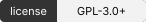
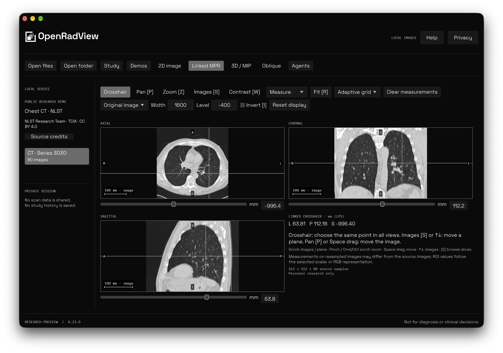

<div align="center">

<picture>
  <source media="(prefers-reduced-motion: reduce) and (prefers-color-scheme: dark)" srcset="assets/brand/logo-dark.svg">
  <source media="(prefers-reduced-motion: reduce)" srcset="assets/brand/logo-light.svg">
  <source media="(prefers-color-scheme: dark)" srcset="assets/brand/logo-animated-dark.svg">
  
</picture>

<h1>Open your own CT, MRI and X-ray images</h1>

<p align="center">
<a href="LICENSE"></a>
<a href="Cargo.toml"></a>
<a href="docs/architecture.md"></a>
<a href="PRIVACY.md"></a>
</p>

[Features and limits](docs/supported-formats.md) · [Platforms](docs/platforms.md) · [Agent setup](docs/agent-access.md) · [Build](CONTRIBUTING.md)

</div>

OpenRadView is a free, open-source viewer for opening and exploring your own medical images on your computer. It is a personal research project for education, built with Rust, egui and wgpu.

Images stay on your device during local viewing. There is no app account, telemetry or advertising. Optional agent sharing needs your approval; update checks contact GitHub when enabled or requested.

**Not clinically validated. Do not use OpenRadView for diagnosis, treatment or decisions about care. Images and measurements can be wrong; ask a qualified clinician to interpret your scans.** [Disclaimer](DISCLAIMER.md) · [Privacy](PRIVACY.md)

<p align="center">
  
</p>

*Linked MPR with the included public NLST chest CT. [Image credits](docs/screenshots/README.md).*

## Explore locally

| Capability | What is available |
| --- | --- |
| Open images | DICOM files, folders and ZIP/ZIP64; supported NIfTI-1/2 single or paired files, including gzip. Time points and components stay separate; complex presentations are explicit. |
| Navigate | Slice scrolling, pan, zoom, contrast, presets, fit, invert, reset, 90° rotation and flips. Searchable series list with temporary previews and decoder-paced image playback. |
| Compare planes | Linked axial/coronal/sagittal MPR and oblique slices from a validated regular volume, including scalar maximum/minimum slabs with explicit thickness and sample counts. NIfTI scanner, aligned and template references stay distinct. |
| Compare series | Two local source panes with independent controls and optional physical slice linking for compatible geometry. Entering comparison ends agent sharing. |
| View in 3D | Experimental GPU volume rendering and MIP with transfer controls and refinement after interaction. Projections use the loaded data; no anatomy is inferred. |
| Inspect pixels | Image information, histograms, nearest-pixel values, temporary distance/angle marks and scalar/RGB rectangle statistics. Declared padding and missing samples are excluded. Physical measurements are disabled on slab projections. |
| View color | Supported 8/16-bit RGB/YBR, palettes and embedded RGB input ICC conversion to sRGB. Source code values stay separate; the app does not calibrate your monitor. |
| Add local labels | Brush, erase, scalar threshold fill, undo, matching NIfTI import and explicit NIfTI-2 export. No organ recognition, bundled AI model or DICOM SEG/RTSTRUCT support. |
| Save a picture | Image-only PNG and reproducible view settings from a completed pane. Saves are explicit and leave original files unchanged. Check for text burned into pixels before sharing. |

Large studies are indexed before pixels are decoded. The decoded-slice cache and active-volume allowance adapt to physical memory, with shared ceilings up to 8 GiB each and lower limits under pressure. These are working-set limits, not study-file size limits. Color buffers and validity masks count toward admission. Prepared sources are reused while a view needs them. GPU limits and available resources may require 2D/MPR; larger series remain available in indexed 2D. Tests cover sparse files and ZIP64 archives above 4 GiB. Compressed reverse or distant navigation may take longer. [Supported formats and limits](docs/supported-formats.md)

## Connect your own agent

Open **Agents** and copy the setup prompt or MCP configuration into your local client. The connector discovers running apps and available ports. If several are open, `list_instances` lets you choose one.

Each sharing session opens a review with the recipient, selected series, preview and tools. Study data stays private until you choose **Allow**. Advanced permissions can restrict tools or require exact-view review. Revoke, changing or closing the series, or quitting ends access. Other series and arbitrary file paths stay outside the grant.

Approved agents can request snapshots, adjust supported views and query geometry or measurements. Replies are experimental AI commentary and can be wrong. Your client/provider controls onward sharing, retention and training; OpenRadView cannot enforce those settings or remove identifying text burned into pixels. [Setup, tools and permissions](docs/agent-access.md)

## Updates and platforms

Automatic GitHub update checks are enabled by default in standalone installations. Turn them off on first launch or in **Privacy → Updates**, where you can also check manually. Debian packages disable automatic checks and in-app installation; download a newer `.deb` and install it with your package manager. Checks contain no study data; GitHub receives ordinary connection information, app version and platform. Download, installation and restart require your action. The updater verifies signed manifests, target, size and hashes and supports rollback.

Apple Silicon with Metal has native UI checks. Windows and Linux builds are previews with native CI tests, GPU rendering and installer checks. Broader interactive desktop, accessibility, consumer GPU performance and older-version update acceptance remain pending. [Platform status](docs/platforms.md) · [Validation scope](docs/validation.md)

## Build from source

```sh
cargo run -p orv-app                        # Viewer without integrations
cargo run -p orv-app --features mcp,updates  # Viewer with agent and updater support
sh scripts/bundle-macos.sh                  # Optimized local macOS app and connector
```

Use the pinned Rust toolchain, CMake and your platform's development tools. macOS bundles need Xcode. Fonts and codecs are bundled; the installed app does not download them. [Contributing and development](CONTRIBUTING.md) · [Architecture](docs/architecture.md) · [Release process](docs/github-release.md)

Built by [gyorgy.sh](https://gyorgy.sh). Licensed under [GPL-3.0-or-later](LICENSE); dependencies, fonts and demo images retain their own notices, available in **Help → Third-party licenses**.
